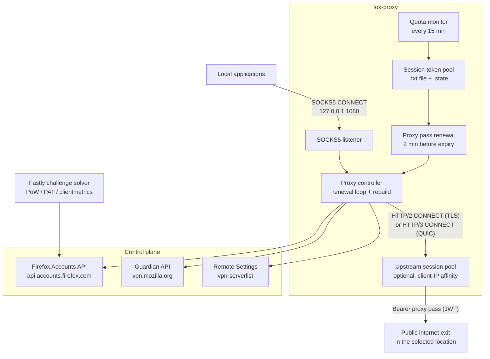

# 🦊 Firefox VPN Client

<div align="center">

**Unofficial Go client for the Mozilla VPN proxy network**

Logs in to Firefox Accounts, fetches a Guardian proxy pass, and exposes a local SOCKS5 CONNECT proxy over upstream HTTP/2 or HTTP/3 VPN sessions — with a built-in Fastly anti-bot challenge solver and automatic session token rotation.

[](https://go.dev/)
[](https://en.wikipedia.org/wiki/SOCKS)
[](https://httpwg.org/specs/rfc9113.html)
[](https://httpwg.org/specs/rfc9114.html)
[](https://github.com/quic-go/quic-go)
[](https://systemd.io/)

[](.golangci.yml)
[](#-fastly-anti-bot-challenge)
[](#-authentication)
[](#-authentication)
[](https://github.com/4q4r/firefox-vpn-client/commits/master)
[](https://github.com/4q4r/firefox-vpn-client)

[Architecture](#-system-architecture) · [Quick Start](#-quick-start) · [CLI](#-cli-reference) · [Security](#-security) · [Development](#-development)

</div>

---

## 📑 Table of Contents

- [System Architecture](#-system-architecture)
- [Project Structure](#-project-structure)
- [Core Modules](#-core-modules)
- [Authentication](#-authentication)
- [Fastly Anti-Bot Challenge](#-fastly-anti-bot-challenge)
- [Guardian Proxy Passes](#-guardian-proxy-passes)
- [Server List & Location Selection](#-server-list--location-selection)
- [Session Token Pool](#-session-token-pool)
- [Data Plane](#-data-plane)
- [CLI Reference](#-cli-reference)
- [Quick Start](#-quick-start)
- [systemd Deployment](#-systemd-deployment)
- [Configuration](#-configuration)
- [Security](#-security)
- [Development](#-development)
- [Testing](#-testing)
- [Troubleshooting](#-troubleshooting)

---

## 🗺️ System Architecture



Control-plane startup flow:

1. The client loads saved OAuth tokens from `~/.firefox-vpn-tokens.json`, refreshes a stale access token, or prompts for email and password. The password is stretched with PBKDF2 and HKDF into an `authPW` value first — the raw password never leaves the machine.
2. Unverified logins are confirmed with a code emailed by Firefox Accounts (or the confirmation link, when FxA chooses that method), then exchanged for OAuth access and refresh tokens with the `profile https://identity.mozilla.com/apps/vpn` scope.
3. FxA API requests answered with HTTP 406 are transparently retried after solving the Fastly anti-bot client challenge and carrying the earned cookie (see [Fastly Anti-Bot Challenge](#-fastly-anti-bot-challenge)).
4. The Guardian API returns a proxy pass (a JWT) plus monthly quota headers. A rejected token triggers an OAuth refresh and account activation; an exhausted quota rotates the session token pool (see [Session Token Pool](#-session-token-pool)).
5. The Mozilla VPN server list is fetched from Remote Settings, and `-country`, `-proxy`, or `-proxy-state-file` selects the upstream CONNECT proxy (see [Server List & Location Selection](#-server-list--location-selection)).
6. One or more upstream sessions are established — HTTP/2 over TLS by default, HTTP/3 over QUIC with `-h3` — and a background loop renews the proxy pass 2 minutes before expiry.

Data-plane flow:

1. An application connects to the local SOCKS5 listener and sends a CONNECT request for `host:port`.
2. fox-proxy opens a CONNECT tunnel on an upstream session, authenticating with `Proxy-Authorization: Bearer <proxy pass>`.
3. Bytes are copied bidirectionally through recycled 64 KiB buffers; a normal half-close drains for at most 2 minutes so slots cannot leak.
4. Dead upstream sessions are detected with keepalive pings and session-level failure tracking, then rebuilt transparently (see [Data Plane](#-data-plane)).

---

## 📂 Project Structure

```text
firefox-vpn-client/
├── cmd/proxy-demo/
│   └── main.go                    CLI entry point: SOCKS5 server, upstream session
│                                  pool, proxy pass renewal, token rotation
├── fastly.go                      Fastly anti-bot challenge solver (PoW, PAT, clientmetrics)
├── fxa.go                         Firefox Accounts login, email 2FA, OAuth tokens, Hawk auth
├── guardian.go                    Guardian proxy passes, activation, quota headers
├── tokens.go                      OAuth token persistence (0600, atomic replace)
├── serverlist.go                  Mozilla VPN server list from Remote Settings
├── http_client.go                 Shared control-plane HTTP client with cookie jar
├── http_headers.go                MozillaVPN User-Agent and Accept headers
├── scripts/
│   └── install-systemd.sh         systemd install / login / health / uninstall helper
├── .golangci.yml                  Strictest lint gate: every linter enabled, 0 issues
└── OPERATOR.md                    Operator notes (Chinese): tuning and troubleshooting
```

---

## 🧩 Core Modules

| Module | Purpose | Key entry points |
| :-- | :-- | :-- |
| `vpnclient` (root) | Control-plane client: FxA, Guardian, Remote Settings, challenge solver | `FxaLogin`, `FxaOAuthToken`, `FxaRefreshToken`, `FetchProxyPass`, `ActivateGuardian`, `FetchServerList`, `SaveTokens` |
| `cmd/proxy-demo` | SOCKS5 listener, upstream HTTP/2 / HTTP/3 CONNECT sessions, renewal loop, session token pool | `main` |
| `fastly.go` | Solves the Fastly client challenge (PoW / PAT / clientmetrics) and installs the earned cookie | `solveFastlyChallenge` |
| `fxa.go` | Password login with PBKDF2+HKDF `authPW`, email 2FA verification, OAuth token exchange | `FxaLogin`, `FxaVerifySession` |
| `guardian.go` | Fetches the proxy pass JWT and quota headers; activates the account; corrects skewed claim times | `FetchProxyPass`, `ActivateGuardian`, `FetchUserInfo` |
| `tokens.go` | Persists OAuth tokens to `~/.firefox-vpn-tokens.json` with owner-only permissions | `LoadTokens`, `SaveTokens`, `DeleteTokens` |
| `serverlist.go` | Reads the Country → City → Server tree from Mozilla Remote Settings | `FetchServerList` |
| `http_client.go` | One shared HTTP client (30 s timeout, cookie jar) for all API requests | `doControlPlane` |

---

## 🔐 Authentication

The FxA flow in `fxa.go` mirrors the onewire protocol Firefox Accounts expects from a
non-browser client:

1. **Password stretching** — the password is never sent. It is stretched with
   PBKDF2-SHA256 (1000 rounds) into a `quickStretchedPW` salted with the account
   email, then derived through HKDF into the 32-byte `authPW` submitted to
   `/account/login`.
2. **Email 2FA** — login requests the `email-2fa` verification method, so an
   unverified session is confirmed with a code emailed to the account instead of a
   confirmation link (which redirects through a browser-facing page). If the FxA
   deployment rejects the `verificationMethod` field (errno 107), the client falls
   back to a plain login and also accepts the link flow interactively.
3. **Hawk-signed session calls** — session-scoped requests (`/session/verify_code`,
   `/oauth/token`) are signed with Hawk credentials derived from the session token
   via HKDF.
4. **OAuth tokens** — the session token is exchanged at `/oauth/token` with client
   id `5882386c6d801776` and scope `profile https://identity.mozilla.com/apps/vpn`,
   requesting an offline-access refresh token.
5. **Persistence** — tokens are saved to `~/.firefox-vpn-tokens.json` with `0600`
   permissions via an atomic temp-file rename. A saved access token counts as valid
   until 60 seconds before its expiry; a stale one is refreshed from the saved
   refresh token. `-login` ignores saved tokens and forces a fresh interactive
   login.

All control-plane requests identify as `MozillaVPN/2.35.0 (sys:linux; iap:true)`.

---

## 🛡️ Fastly Anti-Bot Challenge

Firefox Accounts is fronted by a Fastly edge that sometimes answers API requests
with an empty HTTP 406 client challenge. `fastly.go` solves it automatically:

- The solver fetches the challenge page, downloads the challenge script, and parses
  the trailing `init([...], "token", ...)` call.
- Supported challenge types:
  - **`pow`** — brute-forces a two-character suffix (62² search space) so that
    `SHA-256(base + suffix)` matches the target hash.
  - **`pat`** — requests a Private Access Token; a 401/400 (this CLI cannot mint
    browser PATs) posts an empty auth, which makes Fastly fall back to solvable
    challenges.
  - **`clientmetrics`** — posts a benign browser-metrics payload.
- Answers are posted to `fst-post-back` for up to 3 rounds, the solved cookie is
  probed against the original page, and then installed into the shared control-plane
  client's cookie jar (issued with `Domain=firefox.com`).
- Each FxA call retries up to 5 times with a freshly solved cookie. Solving is
  serialized process-wide because the cookie is bound to the exit IP that solved it
  — with a rotating-exit network the cookie can be rejected on replay. Use
  `-api-proxy` to route the control plane through a fixed exit when this repeats.

---

## 🎟️ Guardian Proxy Passes

`guardian.go` talks to the Guardian API (`https://vpn.mozilla.org` by default,
overridable with `-guardian`):

| Endpoint | Method | Purpose |
| :-- | :-- | :-- |
| `/api/v1/fpn/token` | `GET` | Fetch the proxy pass JWT with `X-Quota-Limit`, `X-Quota-Remaining`, `X-Quota-Reset` headers |
| `/api/v1/fpn/status` | `GET` | Read the account's subscription entitlement |
| `/api/v1/fpn/activate` | `POST` | Activate the account for proxy access |

Behavior verified in the code:

- **HTTP 429** — monthly quota exhausted (`ErrQuotaExceeded`); rotates the session
  token pool when one is configured.
- **HTTP 401/403** — token rejected (`ErrTokenInvalid`); recovered by refreshing the
  OAuth token and, if needed, activating the account, then rotating the pool.
- **Claim-time correction** — proxy pass JWT claims (`nbf`/`exp`) are checked against
  the local wall clock; a skewed clock is detected by sweeping timezone-like
  offsets in 15-minute steps and corrected before the pass is used.
- `-print-info` prints the user info, quota, and the full server list, then exits.

---

## 🌍 Server List & Location Selection

The server list comes from Mozilla Remote Settings
(`firefox.settings.services.mozilla.com`, collection `vpn-serverlist`) and is decoded
into a Country → City → Server tree, where each server lists its protocols
(`connect`, `masque`) and a `quarantined` flag.

Selection rules (from `cmd/proxy-demo/main.go`):

- Only non-quarantined servers with a `connect` protocol (or a bare `hostname:port`)
  become upstream candidates.
- `-country` matches a country **code or name** from the list; `-proxy` pins an exact
  upstream and is mutually exclusive with `-country`.
- With neither flag set: exactly one available country auto-selects; multiple
  countries abort startup with
  `multiple VPN countries are available; pass -country CODE or -proxy HOST:PORT` —
  the client never picks a random country.
- `-proxy-state-file` persists the chosen upstream (hostname plus location
  metadata) and reuses it on the next start. The selection is cleared only after 3
  consecutive startup failures. Persistence is best-effort hostname reuse: it does
  not pin a physical site, network path, or public exit IP.
- `-verify-exit` (default on) probes the actual public exit IP and country through
  the tunnel after startup and warns when it differs from the configured location.
  The probe is non-fatal.

---

## 🔁 Session Token Pool

`-session-token` accepts a single session token or a path to a `.txt` file with one
token per line (blank lines, `#` comments, and duplicates are skipped):

- The current token's remaining monthly quota is polled every 15 minutes, so
  rotation happens as soon as a token is exhausted — without waiting for the proxy
  pass itself to expire.
- Rotation triggers: HTTP 429 or `X-Quota-Remaining: 0` (quota exhausted), or
  401/403 with refresh and activation both ineffective (token rejected).
- Activation progress is persisted to `<token-file>.state`, bound to the token
  file's SHA-256 — editing the file restarts from the first token, while restarts
  resume from the last active one.
- When the pool is exhausted the client exits:
  `no session tokens left in the pool; wait for the monthly quota reset or provide a
  new token file`.

---

## 🔀 Data Plane

- **Local SOCKS5** — no-auth SOCKS5 CONNECT on `-listen` (default `127.0.0.1:1080`).
  `-handshake-timeout` bounds the client handshake; `-idle-timeout` (default `0`,
  disabled) bounds idle tunnels; `-max-conns` (default 256) bounds concurrent
  connections.
- **Upstream sessions** — HTTP/2 over a single TLS connection (ALPN `h2`) by
  default; `-h3` switches to HTTP/3 over QUIC (quic-go). Each CONNECT tunnel
  carries `Proxy-Authorization: Bearer <proxy pass>`.
- **Session pool** — `-upstream-conns N` (default 1) runs N upstream sessions with
  client-IP affinity: a client sticks to one session across requests and only falls
  back when that session fails. For a single client or sing-box exit, keep `1` —
  extra sessions add redundancy for multiple independent clients, not bandwidth.
- **Liveness** — HTTP/2 pings after 30 s idle (15 s pong deadline) close half-open
  connections; dead sessions are detected before they are reused. A session is
  declared failed only after 3 *distinct* targets fail consecutively with open
  timeouts or 502s — a single flaky site never causes an exit change.
- **Renewal** — the proxy pass is renewed 2 minutes before expiry, preferring an
  in-place bearer-token update on the live session (so the exit does not rotate);
  the session is rebuilt only when it is confirmed broken. A renewal that is stuck
  for 2 minutes exits the process so the supervisor can restart it.
- **Exit verification** — a startup probe through the tunnel fetches the exit IP
  and country from `-exit-check-url` (default `https://www.cloudflare.com/cdn-cgi/trace`)
  and logs `exit verified ip=... country_code=... data_path_probe_latency=...`.

---

## 🖥️ CLI Reference

All flags from `cmd/proxy-demo/main.go`:

| Flag | Default | Description |
| :-- | :-- | :-- |
| `-country` | *(empty)* | Mozilla VPN location country code or name used when selecting an upstream proxy |
| `-proxy` | *(empty)* | Exact upstream proxy URL or `host:port`; mutually exclusive with `-country` |
| `-listen` | `127.0.0.1:1080` | Local SOCKS5 listen address |
| `-login` | `false` | Force fresh login (ignore saved refresh token) |
| `-print-info` | `false` | Print user info, quota info, and server list, then exit |
| `-session-token` | *(empty)* | Session token, or path to a `.txt` file with one token per line; tokens rotate automatically when their monthly quota runs out |
| `-api-proxy` | *(empty)* | Optional HTTP/HTTPS/SOCKS5 proxy for Firefox Accounts, Guardian, and Remote Settings API requests |
| `-guardian` | `https://vpn.mozilla.org` | Guardian API endpoint |
| `-timeout` | `20s` | Upstream dial and handshake timeout |
| `-handshake-timeout` | `10s` | Maximum time for a client SOCKS5 handshake; `0` disables the limit |
| `-idle-timeout` | `0` | Maximum idle time for an established tunnel; `0` disables the limit |
| `-max-conns` | `256` | Maximum concurrent client connections; `0` disables the limit |
| `-upstream-conns` | `1` | Number of upstream proxy sessions; client-IP affinity when above 1 |
| `-h3` | `false` | Use HTTP/3 (QUIC/UDP) instead of HTTP/2 (TCP) for the upstream connection |
| `-verify-exit` | `true` | Verify the actual public exit IP and country with a non-fatal HTTPS data-path probe |
| `-exit-check-url` | `https://www.cloudflare.com/cdn-cgi/trace` | HTTPS endpoint returning Cloudflare-trace or JSON exit IP and country fields |
| `-exit-check-timeout` | `10s` | Maximum duration of the exit verification probe |
| `-proxy-state-file` | *(empty)* | Persist the automatically selected upstream proxy to this file; disabled when empty |
| `-status-file` | *(empty)* | Write runtime health status JSON to this file; disabled when empty |
| `-verbose` | `false` | Verbose per-connection logs, including CONNECT target hosts |

---

## 🚀 Quick Start

### 1. Prerequisites

- Go 1.25 or newer.
- A Firefox Account you own with access to the Mozilla VPN proxy (the Guardian
  entitlement — the same account where VPN works in the Firefox browser).
- Any platform with a Go toolchain can build and run the client; the systemd
  helper is Linux-only.

### 2. Build

```bash
go build -o fox-proxy ./cmd/proxy-demo
```

### 3. Log in once

```bash
./fox-proxy -login -print-info
```

Enter the account email and password when prompted. If the sign-in must be
confirmed, enter the verification code sent to the account email (or open the
emailed confirmation link and press Enter). `-print-info` then prints the account's
subscription status, quota, and the full server list, and exits. Tokens are saved
to `~/.firefox-vpn-tokens.json` (`0600`) for later runs.

### 4. Run the SOCKS5 proxy

```bash
./fox-proxy -country {COUNTRY_CODE} -listen "127.0.0.1:9999"
```

`{COUNTRY_CODE}` is a country code or name from the Mozilla server list (use
`-print-info` to see them). Pick a location explicitly with `-country` or
`-proxy`; the only exception is a server list with exactly one available
country, which selects itself. The chosen hostname is then reused automatically
when a `-proxy-state-file`/systemd state file is configured.

### 5. Point applications at it

Configure any SOCKS5-capable client to use `127.0.0.1:9999` and check the startup
logs:

```text
INFO  SOCKS5 proxy started listen=127.0.0.1:9999 upstream=... proxy_pass_exp=...
INFO  upstream selected configured_country="United States" ... selection_source=configured_country ...
INFO  exit verified ip=203.0.113.10 country_code=US data_path_probe_latency=241ms probe_host=www.cloudflare.com
```

`exit verified` is the data-plane truth: the public exit actually observed through
the tunnel.

---

## 🏗️ systemd Deployment

`scripts/install-systemd.sh` installs and manages a hardened system service on
Linux. It builds the binary to `/usr/local/bin/firefox-vpn-proxy`, creates the
`firefox-vpn` system user with a `nologin` shell and the `0700` state directory
`/var/lib/firefox-vpn-client`, writes `/etc/default/firefox-vpn-client`, and installs
`firefox-vpn-client.service` plus a `firefox-vpn-client-health.timer` (30 s
interval by default).

```bash
sudo COUNTRY=US LISTEN=127.0.0.1:1088 ./scripts/install-systemd.sh install-login
```

This performs a full install and then an interactive login as the service user
(tokens land in the service user's home,
`/var/lib/firefox-vpn-client/.firefox-vpn-tokens.json`, with `0600` permissions)
and starts the service. The service only starts when a location
is configured (`PROXY` or `COUNTRY`, or a non-empty persisted selection) and a token
file exists.

Actions:

| Action | Purpose |
| :-- | :-- |
| `install` | Build, write config/units, enable and start (when tokens + location exist) |
| `login` | Interactive login as the service user, then start |
| `install-login` | `install` with `SKIP_START=1`, then `login` |
| `health` | Run the installed health check on demand |
| `status` | `systemctl status` for the service and timer |
| `restart` | Restart the service and timer |
| `uninstall` | Remove units, binary, config; keep state (`PURGE=1` also removes state and the user) |

The health check (runs from the timer): verifies the service is `active` (an
`inactive` service is treated as intentionally stopped and left alone); with
`python3` present it reads `-status-file` and fails when the proxy pass is past
`proxy_pass_expires_at + HEALTH_STATUS_GRACE`, performs a SOCKS5 greeting and a
CONNECT through the proxy to every `HEALTH_TARGETS` entry (with a TLS + HTTP probe
for `:443` domains), and restarts the service only after
`HEALTH_FAILURE_THRESHOLD` consecutive all-target failures (systemd start limits
are reset first). Without `python3` it degrades to a local TCP port check.

The unit runs with `NoNewPrivileges`, `PrivateTmp`, `ProtectSystem=full`,
`ProtectHome`, `RestrictAddressFamilies=AF_INET AF_INET6 AF_UNIX`, and
`LimitNOFILE=65535`, with writes confined to the state directory.
`Restart=always` (10 s) keeps the proxy up across transient failures.

This README documents the shipped install path; deploying or replacing a running
instance is an operator decision (see [OPERATOR.md](OPERATOR.md)).

---

## ⚙️ Configuration

Under systemd, all knobs live in `/etc/default/firefox-vpn-client` (edit with
`sudoedit`, then `systemctl restart firefox-vpn-client.service`). Defaults from
`scripts/install-systemd.sh`:

| Variable | Default | Maps to |
| :-- | :-- | :-- |
| `LISTEN` | `127.0.0.1:1080` | `-listen` |
| `PROXY` | *(empty)* | `-proxy` |
| `COUNTRY` | *(empty)* | `-country` |
| `PROXY_STATE_FILE` | `$STATE_DIR/proxy-selection.json` | `-proxy-state-file` |
| `SESSION_TOKEN` | *(empty)* | `-session-token` (single token or pool file path, readable by the service user) |
| `GUARDIAN` | *(empty)* | `-guardian` |
| `TIMEOUT` | `20s` | `-timeout` |
| `HANDSHAKE_TIMEOUT` | `10s` | `-handshake-timeout` |
| `IDLE_TIMEOUT` | `0` | `-idle-timeout` |
| `MAX_CONNS` | `256` | `-max-conns` |
| `UPSTREAM_CONNS` | `1` | `-upstream-conns` |
| `USE_H3` | `0` | `-h3` |
| `VERIFY_EXIT` | `1` | `-verify-exit` |
| `EXIT_CHECK_URL` | `https://www.cloudflare.com/cdn-cgi/trace` | `-exit-check-url` |
| `EXIT_CHECK_TIMEOUT` | `10s` | `-exit-check-timeout` |
| `VERBOSE` | `0` | `-verbose` |
| `EXTRA_ARGS` | *(empty)* | Extra CLI flags, whitespace-split (keep secrets out) |
| `HEALTH_INTERVAL` | `30s` | Health timer period |
| `HEALTH_TIMEOUT` | `5` | Per-probe timeout (seconds) |
| `HEALTH_VERBOSE` | `0` | Log healthy checks too |
| `HEALTH_TARGET` | *(empty)* | Legacy single health target |
| `HEALTH_TARGETS` | `www.google.com:443,example.com:443` | Comma-separated CONNECT probe targets |
| `HEALTH_FAILURE_THRESHOLD` | `3` | Consecutive failures before restart |
| `HEALTH_FAILURE_STATE` | `$STATE_DIR/health-failures` | Failure counter file |
| `HEALTH_STATUS_GRACE` | `30` | Seconds of grace past proxy pass expiry |
| `STATUS_FILE` | `$STATE_DIR/status.json` | `-status-file` |

`PROXY` and `COUNTRY` are mutually exclusive. Values passed as environment
variables to the install command override the env file for that run; existing
tokens and config are preserved across reinstalls.

Performance guidance (from the operator notes, all defaults verified in code):

- The defaults are conservative for single-user use. For a shared exit or sing-box,
  start with `MAX_CONNS=1024`, `UPSTREAM_CONNS=1`, `IDLE_TIMEOUT=5m`.
- `IDLE_TIMEOUT=5m` reaps long-idle tunnels so abandoned client connections cannot
  occupy all `-max-conns` slots; keep `0` for long-lived protocols such as SSH or
  WebSocket.
- `MAX_CONNS` must stay below the file-descriptor limit (the unit sets
  `LimitNOFILE=65535`).
- `VERBOSE=1` adds log I/O and lock contention — enable it only for debugging.

---

## 🔒 Security

- **Loopback-only by default** — the SOCKS5 listener binds `127.0.0.1`. Do not
  expose it to a public network.
- **Owner-only token storage** — `~/.firefox-vpn-tokens.json` is written `0600`
  through an atomic temp-file rename. The token file is a long-lived login
  credential; a session token pool file deserves the same `0600` care.
- **No raw password on the wire** — login sends only the PBKDF2+HKDF-stretched
  `authPW`; session-scoped FxA requests are Hawk-signed.
- **CONNECT targets redacted by default** — logs show
  `target=<redacted; use -verbose>`. `-verbose` writes the sites clients visit into
  the logs; keep it off outside debugging.
- **Hardened systemd unit** — dedicated `firefox-vpn` system user, `nologin` shell,
  `NoNewPrivileges`, `PrivateTmp`, `ProtectSystem=full`, `ProtectHome`, restricted
  address families, writes confined to the state directory.
- **Honest exit reporting** — the configured country and the verified public exit
  are logged separately, and a mismatch is warned about rather than hidden.
- **Authorized use only** — this is an unofficial client for your own Firefox
  Account. It depends on Mozilla's interface behavior and may need updates when
  Mozilla changes it.

---

## 💻 Development

The repository runs a strict lint gate — every linter golangci-lint v2 ships
(`default: all` in [.golangci.yml](.golangci.yml)) stays enabled, with a minimal
set of documented settings, and the gate must stay at **0 issues and 0 warnings**:

```bash
test -z "$(gofmt -l .)"
go vet ./...
go test ./...
golangci-lint run ./...
```

Notes:

- Only the three deprecated linter names (`wsl`, `exhaustruct`, `gomodguard`) are
  disabled — their active replacements (`wsl_v5`, `exhaustruct_v5`, `gomodguard_v2`)
  remain enabled through the `all` set.
- Complexity thresholds (`cyclop` 15, `funlen` 80 lines / 60 statements, `nestif`
  12) are pinned just above the observed maxima so new regressions fail the gate
  without forcing a rewrite of the live connection flows.
- `depguard` allows exactly the module's declared dependencies; anything else is
  rejected.
- The module path is `firefox-vpn-client`; dependencies are quic-go, golang.org/x
  crypto/net/term.

---

## 🧪 Testing

```bash
go test ./...
FXA_E2E=1 go test -run TestSolveFastlyChallengeE2E ./...
```

The unit suite runs offline. The Fastly solver additionally ships a live
end-to-end test that exercises the real challenge flow — it is skipped unless
`FXA_E2E=1` is set and hits live infrastructure.

---

## 🚑 Troubleshooting

All log lines use the `<RFC3339 timestamp> <LEVEL> <message>` format on stderr.

| Symptom | Meaning and remedy |
| :-- | :-- |
| `multiple VPN countries are available` | No location configured. Pass `-country US` (or any code/name from `-print-info`), or pin `-proxy HOST:PORT`. |
| `guardian returned HTTP 403` | Guardian rejected the access token. The client auto-refreshes the OAuth token and activates the account; if it persists, confirm VPN works for this account in the Firefox browser. |
| `Fastly anti-bot challenge ...` / HTTP 406 | The FxA edge is challenging API requests. The client re-solves automatically (up to 5 attempts); repeated failures usually mean a rotating exit IP invalidated the cookie — route the control plane through a fixed exit with `-api-proxy`. |
| `no session tokens left in the pool` | Every pool token is exhausted. Wait for the monthly quota reset or append new tokens to the file (editing it restarts rotation from the first token). |
| `no refresh token available for background renewal` | The token file is missing or outside the service user's home. Under systemd re-login with `sudo ./scripts/install-systemd.sh login`. |
| Configured country shows `unknown` | The `-proxy` host is outside the Mozilla server list or location metadata was unavailable. The proxy still runs — trust the `exit verified` line. |
| `exit verification failed` | Non-fatal probe failure (does not block startup). Check the probe URL's reachability, or disable the probe with `VERIFY_EXIT=0` / `-verify-exit=false`. |
| Service restarts right after start | Check `journalctl -u firefox-vpn-client.service -n 100`: the env file, token file, `LISTEN` port conflicts, and a configured/reachable `COUNTRY`/`PROXY` are the usual causes. |

For latency analysis and tuning (Fastly POPs vs configured location vs actual exit,
`UPSTREAM_CONNS` sizing, health-check targeting), see
[OPERATOR.md](OPERATOR.md) — the canonical operator notes.
